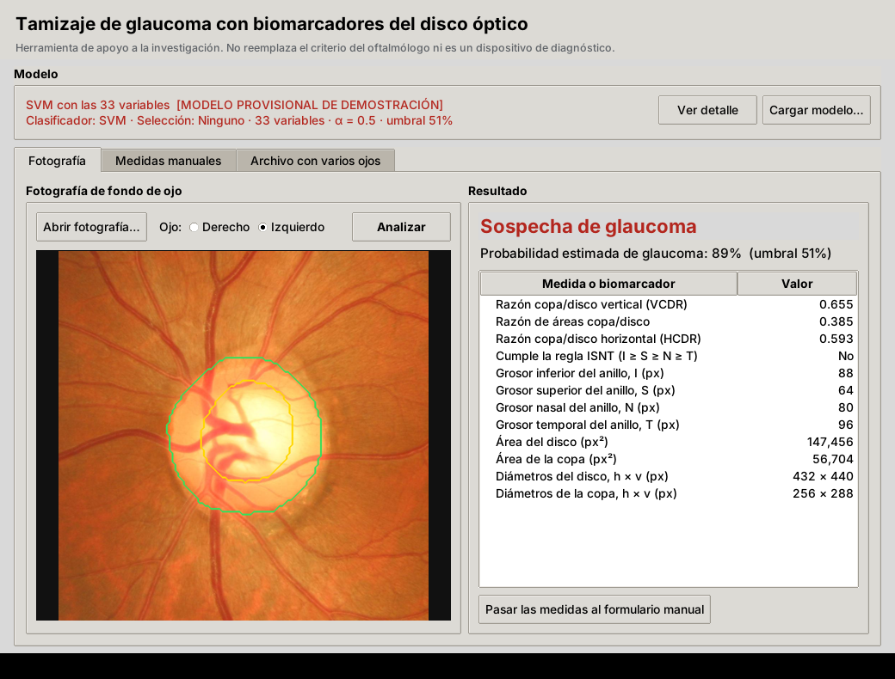

# Tamizaje de glaucoma con biomarcadores del disco óptico

Aplicación de escritorio (Python y Tkinter) que recibe una fotografía de fondo de ojo, segmenta el disco y la copa
ópticos, mide los biomarcadores y clasifica el ojo como **con sospecha** o **sin sospecha de glaucoma**. Es el producto de software del plan de trabajo
*Optimización y despliegue de un sistema de tamizaje de glaucoma basado en la regla ISNT mediante técnicas de
aprendizaje automático* (auxiliatura de investigación, semillero SEIA, Universidad Autónoma de Bucaramanga, 2026).

> Herramienta de apoyo a la investigación. No reemplaza el criterio del oftalmólogo ni es un dispositivo de
> diagnóstico.



## Qué hace

- **Fotografía:** se abre una fotografía de fondo de ojo centrada en el disco (como las de ORIGA) y se indica si es del
  ojo derecho o del izquierdo. La aplicación segmenta el disco y la copa con el Swin Transformer de Bazi et al. (2024),
  aplica el mismo post-procesamiento y las mismas medidas con las que se construyó la base del proyecto, y muestra los
  contornos sobre la imagen (verde, disco; amarillo, copa) junto con el resultado, la probabilidad y las medidas. Si los
  contornos no coinciden con la imagen, el resultado no es confiable. Las medidas se pueden pasar al formulario manual
  para corregirlas.
- **Medidas manuales:** se ingresan el ojo (derecho o izquierdo) y 10 medidas en píxeles de la imagen original: grosores del
  anillo neurorretiniano (I, S, N, T), áreas del disco y de la copa, y diámetros horizontal y vertical de ambos. La
  aplicación calcula las 33 variables del proyecto, aplica el modelo y muestra el resultado, la probabilidad estimada y
  los biomarcadores principales (VCDR, HCDR, razones de áreas, cumplimiento de la regla ISNT).
- **Archivo con varios ojos:** evalúa un CSV o Excel con una fila por ojo y guarda los resultados en Excel o CSV.
- **Modelo intercambiable:** el modelo es un archivo `.joblib` que se carga desde la interfaz. Cuando se elija el
  modelo final del estudio, basta con generarlo y cargarlo; la interfaz no cambia.

## Instalación

Requiere Python 3.11, 3.12 o 3.13 (el instalador de python.org para Windows ya incluye Tkinter). Las dependencias
incluyen PyTorch para la segmentación, así que la primera instalación descarga unos cientos de MB.

**Pesos de la red de segmentación.** El archivo `TrainAll_Maghrabi84_50iteration_SWIN.pth.tar` (unos 430 MB, publicado
por Bazi et al. en Hugging Face) no viene en el repositorio por su tamaño. Se copia en la carpeta `pesos/`; si falta, la
aplicación ofrece descargarlo o buscarlo en el computador. La primera fotografía tarda hasta un minuto mientras se carga
la red; las siguientes, uno o dos segundos en CPU.

**Verificación.** Con las 130 fotografías del conjunto Validation de ORIGA, las 10 medidas que calcula la aplicación
(I, S, N, T, áreas y diámetros) son idénticas a las de la base del proyecto (`crudo-v3`) en el 100 % de los casos.

**Windows:** doble clic en `iniciar_windows.bat`. La primera vez crea un entorno virtual e instala las dependencias.

**Cualquier sistema:**

```bash
python -m venv .venv
source .venv/bin/activate          # en Windows: .venv\Scripts\activate
pip install -r requirements.txt
python app.py
```

## Formato del archivo de entrada

Una fila por ojo, con estas columnas (ver `ejemplos/medidas_ejemplo.csv`):

| Columna | Contenido |
| --- | --- |
| `Tipo_Ojo` | `DERECHO` o `IZQUIERDO` |
| `I`, `S`, `N`, `T` | Grosor del anillo neurorretiniano en cada sector (px) |
| `disc_area`, `cup_area` | Áreas del disco y de la copa (px²) |
| `Disco_X`, `Disco_Y` | Diámetros horizontal y vertical del disco (px) |
| `Excavacion_X`, `Excavacion_Y` | Diámetros horizontal y vertical de la copa (px) |
| `Archivo` (opcional) | Identificador que se conserva en los resultados |

Las medidas deben venir del mismo proceso de segmentación del proyecto (modelo Swin Transformer de Bazi et al., 2024,
sobre imágenes tipo ORIGA de 3072 × 2048, medidas reescaladas a la imagen original). Con otra cámara u otro método de
segmentación las medidas no son comparables y el modelo no está validado.

## Variables que calcula

A partir de las 10 medidas se calculan las 33 variables de la base del proyecto, exactamente igual que en
`dataset-glaucoma-crudo:crudo-v3` (la prueba `pruebas/prueba_variables.py` lo comprueba fila por fila):

- Derivadas exactas: área del anillo, razones de áreas copa/disco y anillo/disco, VCDR y HCDR.
- Regla ISNT: 1 si I ≥ S ≥ N ≥ T.
- Transformaciones: I/S, N/S, cuadrados, productos cruzados y seno (en grados) de I, S, N y T.
- Lateralidad: izquierdo = 1, derecho = 0.

## Modelo incluido

`modelos/modelo_provisional.joblib` es un **modelo de demostración** para probar la aplicación mientras se elige el
modelo final:

- SVM con las 33 variables, normalización Min-Max y balanceo con ADASYN, igual que en el protocolo.
- Hiperparámetros elegidos en la malla de 74 combinaciones con el Score Combinado (α = 0.5) en una validación cruzada
  de 5 folds estratificada por ojo y clase.
- Entrenado con las 552 imágenes de desarrollo de la partición v4. El SuperTest no se usó.
- La probabilidad sale del escalado de Platt; el umbral de decisión es el que maximiza el Score Combinado con
  predicciones fuera de fold.

Su validación cruzada simple (SC 0.773) **no** es una estimación sin sesgo del desempeño. La estimación válida es la
de la validación cruzada anidada del estudio, descrita en el informe técnico del protocolo.

## Cambiar el modelo

Con variables e hiperparámetros ya decididos (por ejemplo, la combinación que elija el director):

```bash
python entrenar_modelo.py --clasificador svm \
    --variables "Cup_Disc_Area_ratio,VCDR,I" \
    --hiperparametros '{"kernel": "rbf", "C": 4, "gamma": 0.25}' \
    --metodo "Elastic Net" --alfa 0.5 \
    --nombre "SVM + Elastic Net (α 0.5)" --salida modelos/modelo_final.joblib
```

Para XGBoost se instala `xgboost` y se usa `--clasificador xgb` con sus hiperparámetros. Para un modelo entrenado en un
notebook (por ejemplo, la red neuronal), se guarda con `tamizaje_glaucoma.modelo.guardar_paquete`: basta con que el
objeto tenga `predict` (y, si se quiere mostrar la probabilidad, `predict_proba`) y reciba un DataFrame con las
columnas de `variables`.

```python
from tamizaje_glaucoma.modelo import guardar_paquete
guardar_paquete("modelos/mi_modelo.joblib", pipeline_entrenado, variables=["Cup_Disc_Area_ratio", "VCDR"],
                nombre="Mi modelo", clasificador="ANN", metodo_seleccion="FSCNCA", alfa=0.5, umbral=0.5)
```

Si un modelo no carga por diferencias de versión de las librerías, se vuelve a generar con `entrenar_modelo.py`
(tarda unos segundos).

## Pruebas

```bash
python pruebas/prueba_segmentacion.py <carpeta de imágenes ORIGA> <base .xlsx>   # medidas idénticas a la base
python pruebas/prueba_variables.py   # las 33 variables coinciden con la base (552 filas)
python pruebas/prueba_modelo.py      # el modelo carga, predice y la validación rechaza medidas imposibles
```

## Estructura

```
app.py                       interfaz Tkinter
pesos/                       pesos de la red de segmentación (no incluidos)
entrenar_modelo.py           entrena y guarda un modelo
tamizaje_glaucoma/
    segmentacion.py          segmentación de la fotografía y medida de los biomarcadores
    variables.py             cálculo y validación de las 33 variables
    modelo.py                formato del paquete de modelo, carga y predicción
modelos/                     modelos .joblib
datos/                       conjunto de desarrollo (partición v4, 552 imágenes)
ejemplos/                    archivo de entrada de ejemplo
pruebas/                     pruebas
iniciar_windows.bat          lanzador para Windows
```

## Datos y créditos

- Imágenes: base pública ORIGA-light (Zhang et al., 2010), copia en figshare (doi 10.6084/m9.figshare.24549217,
  licencia CC BY 4.0). `datos/` contiene solo las medidas derivadas del conjunto de desarrollo.
- Segmentación: Bazi, Y., Al Rahhal, M. M., Elgibreen, H. y Zuair, M. (2024). Vision transformers for segmentation of
  disc and cup in retinal fundus images. *Biomedical Signal Processing and Control*, 91, 105915.
- Autor: Piter Anderson Tarazona Robles. Tutor: Carlos Julio Arizmendi Pereira. Semillero SEIA, UNAB.
